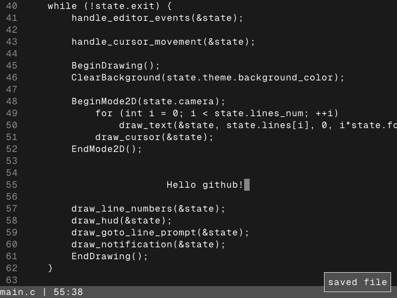

# led (lauchi's editor)
A rudimentary text editor made with [raylib](https://github.com/raysan5/raylib)


## Usage
You will need a C compiler, GNUMake and raylib's source code.

Make sure to specify `RAYLIB_PATH` when calling `make`.
```
$ git clone https://github.com/lauchimoon/led.git
$ cd led
$ make RAYLIB_PATH=/path/to/raylib
$ ./led <file>
```
If `<file>` doesn't exist, `led` will create it.

## Keybinds
- Arrow keys: Movement
- Page Up, Page Down: Scroll
- Enter: New line
- Ctrl + PageUp: Go to the top of the file
- Ctrl + PageDown: Go to the bottom of the file
- Ctrl + C: Copy line
- Ctrl + D: Delete current line
- Ctrl + G: Open line-jumping prompt
- Ctrl + J: Decrease font size
- Ctrl + K: Increase font size
- Ctrl + N: Toggle line numbers
- Ctrl + Q: Exit editor
- Ctrl + S: Save buffer
- Ctrl + T + <1, 2>: Change theme (1 is dark, 2 is white)
- Ctrl + V: Paste line
